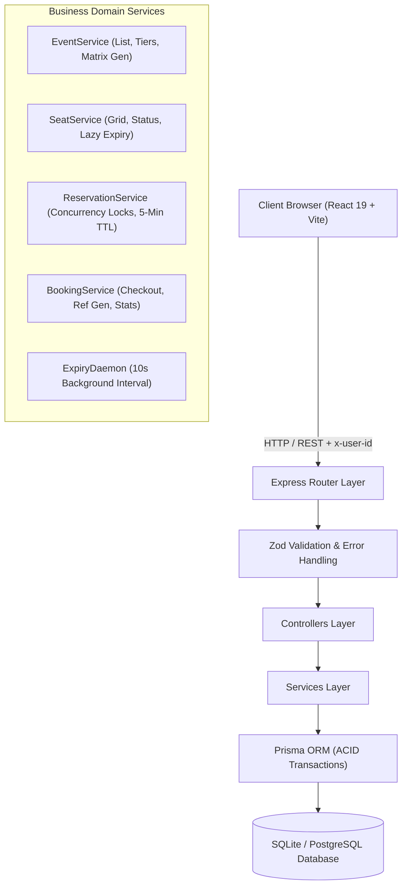
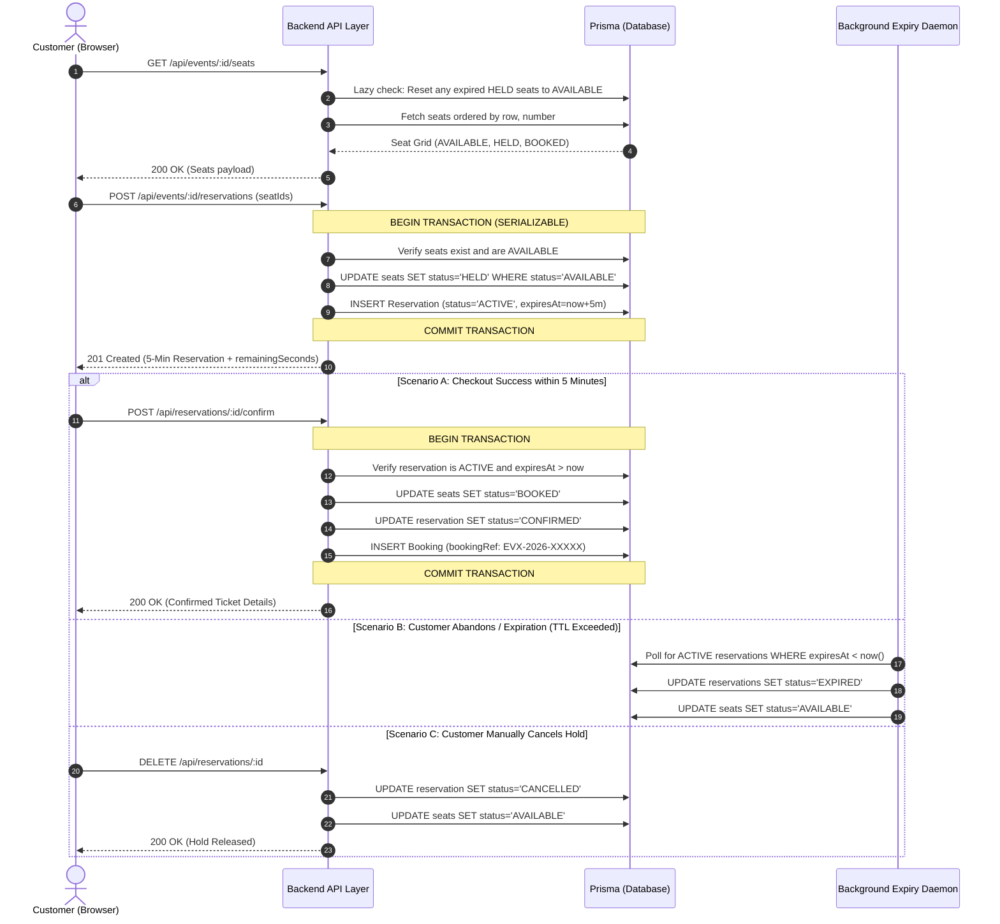
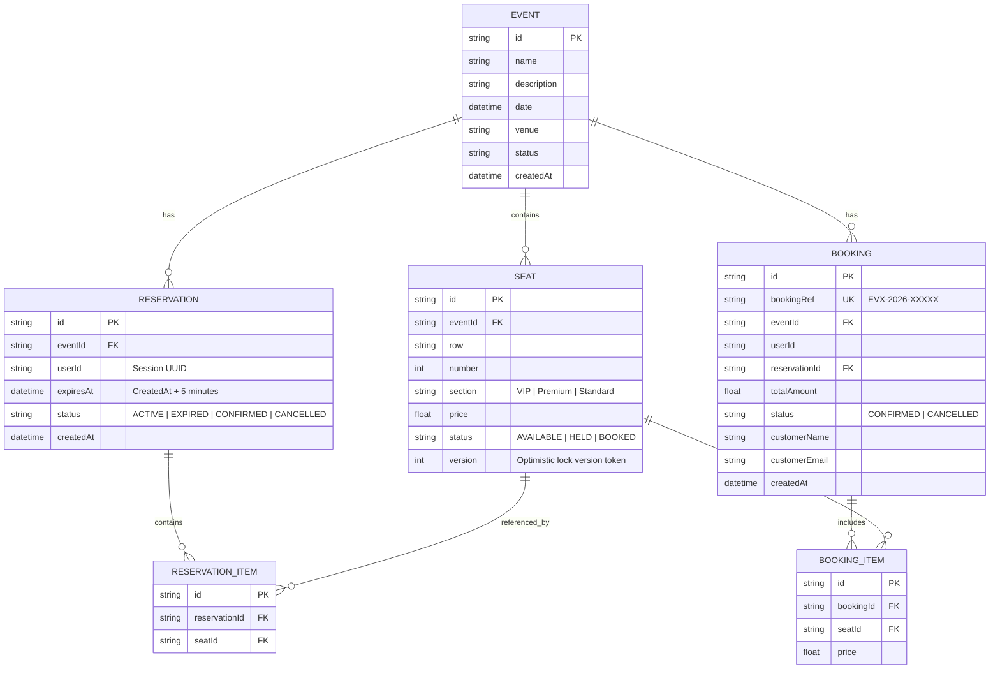

# EVENTRIX System Architecture

ByteVox Event Ticket Booking & Seat Reservation System

---

## 1. High-Level Architecture Overview

EVENTRIX is built as a high-concurrency event ticketing platform with a clean separation of concerns:
- **Client Tier**: React 19 + TypeScript + Vite with a reactive reservation timer context and dynamic seat maps.
- **API Tier**: Node.js + Express + TypeScript implementing 3-tier layering (Routes, Controllers, Services).
- **Data Tier**: SQLite / PostgreSQL managed via Prisma ORM with ACID transaction boundaries.
- **Worker Tier**: An automated 10-second background cleanup daemon coupled with real-time query-level lazy expiration.

---

## 2. End-to-End Booking Lifecycle

---

## 3. Entity-Relationship Diagram (ERD)

